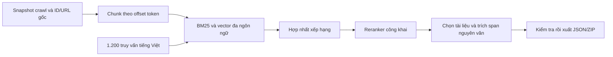

# Hệ thống ViBioMIR cho cuộc thi

Hệ thống dùng **BGE-M3 + BGE reranker v2 M3**, tìm kiếm đa ngôn ngữ kết hợp từ khóa và vector. Theo yêu cầu ngày 13/10/2026, crawler đã dừng và bản chụp chốt có **1.041.242 tài liệu**, thiếu 153.227 ID trong 1.194.469 URL. Nguồn hiện tại là `links_corpus_vi_en_zh.parquet`; corpus nằm ở `corpus_data_vi_en_zh`, checkpoint hệ thống ở `competition\work_vi_en_zh`. PubMed dùng title/abstract Europe PMC đối chiếu PMID; các bản công khai thay thế có nguồn/checksum và giữ URL/ID gốc. Không gọi LLM đóng; không sinh hay viết lại nội dung chunk. **Chưa có điểm thi** vì chưa có nhãn tham chiếu hoặc kết quả BTC; mục tiêu trên 0,5 chưa được kiểm chứng.

## Cách chạy trên máy này

Job chạy nền đã được khởi động với `run_after_crawl.ps1 -UseSnapshot` trên bản chụp đã dừng. Job chuẩn bị dữ liệu training, huấn luyện lớp điều chỉnh vector, tiếp tục chỉ mục, tạo embedding, truy hồi đủ 1.200 câu hỏi và xuất JSON/ZIP. Trạng thái nằm tại `competition\work_vi_en_zh\pipeline_status.json`. Nhấp đúp `D:\R2AI\watch_system.bat` để theo dõi.

Lượt chạy tiếp ghim `source_manifest` vào `corpus_data_vi_en_zh/system_snapshot_20261013.json`, khớp SHA256 bản chụp đã lập chỉ mục (1.041.242 tài liệu, 4.328.424 chunk). Các lượt crawl bổ sung không tự thay đổi nguồn của checkpoint hệ thống. Lượt embedding tiếp tục từ 983.704 chunk đã lưu; muốn thêm nguồn vào hệ thống cần một lần cập nhật chỉ mục có kiểm tra riêng.

Tối ưu tốc độ ngày 13/10: GPU batch 16, bộ đệm đọc 256 chunk, gom theo độ dài token trong từng bộ đệm và trả vector về đúng thứ tự ID. Trên 384 chunk VI/ZH/EN, tốc độ thử nghiệm tăng từ 58,75 lên 91,24 chunk/giây (1,55 lần); cosine tối thiểu so với batch 4 là 0,99996. Đây là phép đo mẫu, tốc độ toàn corpus phụ thuộc độ dài chunk và tài nguyên máy. Trọng số, tokenizer, 240 token/chunk và nguồn không thay đổi. Vector cũ vẫn được giữ; checkpoint ghi mỗi 1.024 chunk hoặc tối đa khoảng 15 giây, chỉ sau khi vector đã flush/fsync. Báo cáo ở `evidence/embedding_speed_20261013.json` và `evidence/embedding_sorted_20261013.json`.

Launcher dùng `supervise_system.ps1` để chạy tiếp checkpoint sau tối đa 5 lần thoát bất ngờ. Nó dừng khi có yêu cầu dừng, bài nộp đã sẵn sàng hoặc pipeline báo lỗi xác minh/cấu hình. Mỗi lượt có log riêng; đường dẫn log hiện tại ở `pipeline_runtime.json`, nhật ký khởi động lại ở `system_supervisor.log`. Không tạo hai pipeline dùng cùng chỉ mục.

Launcher khởi động tiến trình giám sát qua Windows WMI bằng quyền của người dùng hiện tại, tách khỏi cây tiến trình terminal. Không đăng ký tác vụ lịch hay nâng quyền. Nhật ký giám sát ghi bằng transcript; lỗi giám sát được lưu riêng, và trạng thái cuối từ lượt cũ không được dùng để kết luận lượt mới đã hoàn thành. Sau lần cả pipeline và supervisor thoát, embedding đã được yêu cầu chạy tiếp từ checkpoint 1.186.008 chunk.

Để chạy tiếp trên bản chụp đã dừng, nhấp đúp `D:\R2AI\start_system_now.bat`. Script nhận biết job đang chạy và không khởi động thêm. `start_system_after_crawl.bat` vẫn dành cho trường hợp chờ crawler kết thúc tự nhiên. Nhấp đúp `stop_system.bat` để dừng; checkpoint training/chỉ mục/vector/xếp hạng được giữ để chạy tiếp.

Nếu cần chạy lại từ terminal:

```powershell
Set-Location D:\R2AI
& '.\.competition_venv\Scripts\python.exe' -m competition.pipeline run --wait-for-crawl
```

Nếu chủ động muốn dùng bản chụp đã dừng sạch gần nhất dù crawler còn chạy:

```powershell
& '.\.competition_venv\Scripts\python.exe' -m competition.pipeline run --use-snapshot
```

Dừng job nền trước khi dùng cùng hệ thống bằng lệnh trực tiếp. Nếu file control vẫn có `stop=true`, đổi về `false` hoặc dùng launcher để đặt lại. Chỉ một job hệ thống được chạy tại một thời điểm.

`finished_with_missing` là kết thúc giai đoạn crawl có danh sách URL còn thiếu; không có nghĩa đã lấy được 100% URL. Pipeline ghi rõ số thiếu trong `system_manifest.json`. Dừng crawl thủ công (`stopped`) không tự kích hoạt job chờ; chạy tiếp crawl hoặc chủ động dùng `--use-snapshot`.

## Các file đầu ra sau khi chạy xong

| File trong `competition\work` | Nội dung |
|---|---|
| `submission.json` | Đủ 1.200 câu hỏi; `id`, `relevant_docs`, `relevant_chunks` |
| `submission.zip` | Chỉ chứa duy nhất `submission.json` ở thư mục gốc |
| `submission_validation.json` | Kiểm tra ID, đủ câu, chunk nguyên văn và checksum ZIP |
| `system_manifest.json` | Nguồn dữ liệu, SHA256, mô hình, phiên bản, quy định thời gian/tham số |
| `source_snapshot.json` | Bản chụp danh sách shard dữ liệu được dùng |
| `corpus.sqlite` | ID/URL nguồn, tài liệu nén, vị trí chunk và chỉ mục từ khóa |
| `vectors\*.npy` | Vector int8 trên đĩa cùng ID chunk và chuẩn vector |
| `ranked_candidates.json` | Các ứng viên đã xếp hạng để tối ưu tham số khi có nhãn |
| `pipeline_status.json` | Tiến độ hoặc lỗi cần xử lý |

ZIP kết quả không chứa báo cáo, code hoặc thư mục con. Code hệ thống được đóng gói riêng ở `D:\R2AI\vibiomir_system_source.zip`. Không tự tải bài lên Dashboard. Khi có bài nộp thật đã kiểm tra, tải `submission.zip` vào My Submissions theo quy trình của BTC.

ID tài liệu giữ đúng giá trị integer của `links_corpus_vi_en_zh.parquet`; bài nộp hiện dùng **số nguyên JSON** cho `relevant_docs[].doc_id` và `relevant_chunks[].doc_id`. Đây là bắt buộc với scorer hiện tại: chuỗi số bị diễn giải thành namespace `pubmed:<id>` và làm mọi dự đoán thành `unknown_doc`. `id_serialization` trong cấu hình đã chuyển thành `integer`. Không dùng ID tự đặt như `doc_id1`.

Lần chấm đầu ngày 15/10/2026 nhận đủ 1.200 câu nhưng trả `unknown_doc: 13.353` và điểm 0 vì toàn bộ ID tài liệu/chunk được gửi dưới dạng chuỗi số. Đã sửa bằng cách chuyển 23.997 document IDs và 26.825 chunk IDs sang số nguyên, giữ nguyên văn bản chunk, kiểm tra lại với corpus và tạo ZIP mới. Bản cũ được lưu ở `work_vi_en_zh\submission_string_ids.zip`; ZIP cần nộp lại là `work_vi_en_zh\submission.zip`.

## Quy trình truy hồi



Các tài liệu được đối chiếu ID và URL với danh sách gốc trước khi đưa vào chỉ mục. Bản chụp hiện tại đã qua `audit_corpus.py`: không có dòng trùng ID hoặc dòng sai schema. Checkpoint 250.768 tài liệu được giữ sau khi đối chiếu từng ID, URL, toàn văn với JSONL gốc; báo cáo ở `snapshot_transition.json`. Chunk mặc định dài 240 token của tokenizer mô hình, chồng lấn 48 token. Mỗi chunk giữ vị trí ký tự trong tài liệu; việc thêm ngữ cảnh hoặc gộp vùng chồng lấn đều lấy bằng lát cắt của văn bản gốc. Bộ kiểm tra từ chối đoạn viết lại, đoạn của tài liệu khác, ID không tồn tại, thiếu câu hoặc kiểu trường sai.

Embedding liên kết truy vấn tiếng Việt với văn bản tiếng Việt/Anh/Trung trong cùng không gian vector. BM25 bổ sung thuật ngữ y khoa cụ thể; tiếng Trung được lập chỉ mục thêm bằng bigram ký tự. Truy vấn dài có thêm các phần giữa/cuối để hỗ trợ nhiều ý trong một câu hỏi. Reranker xếp hạng các cặp truy vấn–chunk; văn bản dùng làm input mô hình có thể có prefix/truncation nhưng văn bản nộp vẫn là đoạn nguyên văn.

Vector được lượng tử hóa int8 và đọc từng block trên đĩa. Truy hồi dense tính cosine trên toàn bộ vector theo batch, không nạp cả corpus vào RAM. Có checkpoint tại bước nhập liệu, tạo vector và xếp hạng từng câu hỏi; nguồn/mô hình thay đổi sẽ bị từ chối dùng chung checkpoint. Dùng `work_dir` mới khi chuyển sang bản chụp dữ liệu hoặc tokenizer khác.

## Mô hình và nguồn gốc

| Mô hình | Số tham số | Phiên bản ghim |
|---|---:|---|
| [BGE-M3](https://huggingface.co/BAAI/bge-m3) | 567.754.752 | `7b44caba5c06fd6f1ef1d2786261e636c38e4295`, 02/04/2024 UTC |
| [BGE reranker v2 M3](https://huggingface.co/BAAI/bge-reranker-v2-m3) | 567.755.777 | `953dc6f6f85a1b2dbfca4c34a2796e7dde08d41e`, 24/06/2024 UTC |
| [Multilingual E5 small](https://huggingface.co/intfloat/multilingual-e5-small), cấu hình nhẹ | 117.653.760 | `6a0d452a575215f80b8f66276dd4ee5d504942c6`, 17/02/2025 UTC |

Tất cả đều có trọng số công khai, dưới 15B và phiên bản sử dụng có trước **01/08/2026 00:00 UTC+7**. Registry lưu commit SHA, SHA256 trọng số và bằng chứng trong `models.json`/`evidence`. BGE-M3 dùng snapshot có safetensors để chạy với môi trường CUDA hiện tại; không tự cập nhật theo HEAD. Trọng số được kiểm tra checksum, số tham số khi load và tắt `trust_remote_code`. Mô hình được tải để chạy cục bộ, không gửi truy vấn sang API LLM bên ngoài.

Dữ liệu truy hồi lấy từ các URL trong [ViBioMIR](https://huggingface.co/datasets/AIGuruTinix/ViBioMIR), ID/URL gốc được giữ trong SQLite và JSONL. Chưa thêm dữ liệu huấn luyện bên ngoài. Một số URL dùng bản di động chính thức đã kiểm tra ID; chính sách này được ghi trong báo cáo nguồn. Dataset có ghi công **MedKB — Medical Knowledge Base, https://medkb.tinix.ai/** và giấy phép CC BY-NC 4.0 như tài liệu nguồn. BGE-M3/E5 dùng MIT; reranker dùng Apache-2.0 theo metadata công khai đã lưu.

## Training khi chưa có nhãn BTC

`training.py` chọn 512 cặp từ tài liệu mỗi ngôn ngữ, tổng 1.536 cặp. Câu đầu của tài liệu làm truy vấn yếu; phần văn bản tiếp theo làm ngữ cảnh dương. Cả hai giữ span trong nguồn, không dùng 1.200 câu kiểm thử và không gọi mô hình sinh dữ liệu. Đây là bài inverse-cloze với nhãn yếu cùng tài liệu; quan hệ này có thể nhiễu và không phải đáp án BTC.

BGE-M3 công khai được giữ nguyên trọng số. Training contrastive học 1.024 hệ số dương để điều chỉnh vector của cả query và passage; tổng BGE-M3 + lớp điều chỉnh là 567.755.776 tham số, dưới 15B. Không huấn luyện PLM từ đầu hoặc thay bằng mô hình phát hành sau hạn chót. Registry vẫn kiểm tra ngày/commit/checksum của mô hình nền và reranker; checkpoint do đội học được lưu riêng với SHA256.

Tài liệu huấn luyện và holdout được chia bằng hash toàn văn, cấm cùng nội dung nằm ở cả hai tập. Lớp mới chỉ được dùng nếu tăng macro recall@1, không giảm macro recall@5 trên holdout và không giảm recall@1 từng ngôn ngữ quá 0,02. Nếu không đạt, pipeline giữ vector BGE-M3 gốc và vẫn lưu checkpoint training. Phép thử này cùng ngôn ngữ và chỉ đánh giá quan hệ ngữ cảnh yếu; chưa chứng minh truy hồi xuyên ngôn ngữ hoặc F2 thi.

Các file ở `work_vi_en_zh\training`: `pairs.jsonl`, `pairs.manifest.json`, `embedding_checkpoint.json`, `base_vectors.npy`, `adapter.json`, `training_report.json`. Chuẩn bị cặp, mã hóa và training có checkpoint để chạy tiếp. Không có dữ liệu training bên ngoài corpus được thêm vào. Báo cáo training được đưa vào `system_manifest.json` sau khi hoàn thành build/predict.

Lượt ngày 13/10 đã hoàn thành 15 epoch với 1.232 cặp train và 304 cặp holdout. Loss training giảm nhưng macro recall@1 holdout không tăng, nên lớp điều chỉnh không được dùng. Checkpoint và báo cáo vẫn được giữ; pipeline tiếp tục với BGE-M3 gốc. Đây là kết quả của bài ngữ cảnh yếu, không phải điểm thi.

## Đánh giá và mục tiêu điểm

`evaluation.py` tính riêng Precision, Recall, F2 cho từng câu hỏi rồi lấy trung bình; không tính F2 từ Precision/Recall đã lấy trung bình. Đối chiếu chunk chỉ trong cùng câu hỏi và cùng `doc_id`, chuẩn hóa NFKC → giải mã HTML entity → chữ thường → gộp/trim khoảng trắng. LCS giữ thứ tự token, cho phép không liên tiếp; chunk đúng khi ít nhất 40% token tham chiếu khớp. Một chunk có thể tìm thấy nhiều chunk tham chiếu theo quy tắc bạn cung cấp.

Thông tin bạn gửi chưa quy định cách tách token của BTC hoặc cách gộp DOCS/CHUNKS thành FINAL SCORE. Đánh giá cục bộ mặc định dùng `whitespace`, có lựa chọn `cjk_char`; phải chọn đúng tokenizer BTC để so điểm chính xác. Mẫu số 0 mặc định cho metric 0. Không tự giả định công thức FINAL SCORE; kết quả đó để `null` khi chưa có xác nhận.

Khi có nhãn thật dạng JSON cùng cấu trúc ID/docs/chunks:

```powershell
& '.\.competition_venv\Scripts\python.exe' -m competition.pipeline evaluate --qrels D:\R2AI\labels.json
& '.\.competition_venv\Scripts\python.exe' -m competition.pipeline tune --qrels D:\R2AI\labels.json
```

Tuner thử số tài liệu/chunk và lượng ngữ cảnh, chọn trên nhóm tuning và báo cáo trên nhóm validation tách riêng. Có thể cung cấp `--validation-ids` bằng JSON mảng ID. Khi chưa biết công thức FINAL SCORE, dùng trung bình DOCS/CHUNKS F2 làm mục tiêu thay thế và ghi rõ đó không phải điểm BTC. Nếu BTC xác nhận công thức tuyến tính, cung cấp `--final-doc-weight` để dùng đúng trọng số. Nhãn và kết quả Dashboard mới quyết định hệ thống có đạt trên 0,5 hay không.

Các giá trị top-k trong `config.json` là cấu hình ban đầu, chưa được tối ưu bằng nhãn ViBioMIR. Báo cáo sáu metric sẽ nằm trong `evaluation.json` khi có nhãn; không điền số giả vào bảng điểm.

## Kiểm thử đã thực hiện

- Bộ test kiểm tra checkpoint, mất tiến trình ở ranh giới shard cuối, tìm kiếm vector so với kết quả tính đầy đủ, lọc ID/URL, chunk nguyên văn, ZIP và hợp đồng đủ 1.200 câu.
- LCS được đối chiếu với thuật toán quy hoạch động độc lập; kiểm tra ngưỡng đúng 40%, sai doc_id, chuẩn hóa và macro F2.
- Mô hình chính đã chạy thật trên RTX 3050 Ti 4 GB; với truy vấn tiếng Việt về ung thư phổi, embedding/reranker xếp nguồn tiếng Anh và Trung cao hơn tài liệu không liên quan trong mẫu kiểm thử.
- `demo_strong\smoke_report.json` ghi lượt chạy từ đầu tới cuối với mô hình chính, đủ JSON/ZIP của **3 câu giả lập**. Đây không phải bài nộp 1.200 câu và không xác lập điểm cuộc thi. Cấu hình E5 nhỏ cũng có demo riêng; chất lượng xếp hạng thấp hơn trong mẫu này.

Chạy lại khi cần:

```powershell
& '.\.competition_venv\Scripts\python.exe' -m competition.test_system
& '.\.competition_venv\Scripts\python.exe' -m competition.smoke --strong
```

## Tài nguyên và hạn chót

Môi trường Python riêng `.competition_venv` đã cài dependencies, dùng PyTorch `2.5.1+cu121` sẵn trên máy. Mô hình chính chạy FP16 trên GPU, embedding batch 16 và rerank batch 2; các mô hình được load lần lượt. Khi thiếu VRAM, batch tự giảm và thử lại cùng ID. Job chờ ít nhất 650 MB RAM và 1.800 MB VRAM trống trước phần nặng. Cấu hình CPU nhẹ ở `config_compact.json` tiết kiệm bộ nhớ nhưng dùng mô hình nhỏ và không có reranker.

Trên máy khác hoặc khi cần cài lại, chạy `competition\setup.ps1`. Cần runtime PyTorch/CUDA phù hợp nếu dùng cấu hình GPU. Trọng số đã được tải và xác minh trên máy này; khi cache đủ, quá trình mô hình có thể chạy offline. Corpus lớn vẫn cần thời gian tạo chỉ mục/embedding; tiến độ được ghi theo stage.

Các mốc bạn cung cấp đều theo giờ Việt Nam UTC+7: public test phát hành 01/10/2026; public submission hạn **31/10/2026 23:59**; private test 01/11/2026; hệ thống hạn **04/11/2026 23:59**; kết quả 11/11/2026. Nộp kết quả cho toàn bộ 1.200 câu, để BTC tự chọn phase. Không tự nộp thử liên tục hay dò đáp án bằng Dashboard.
